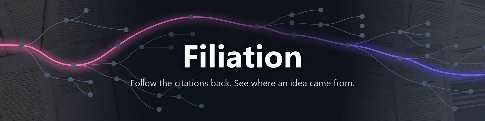
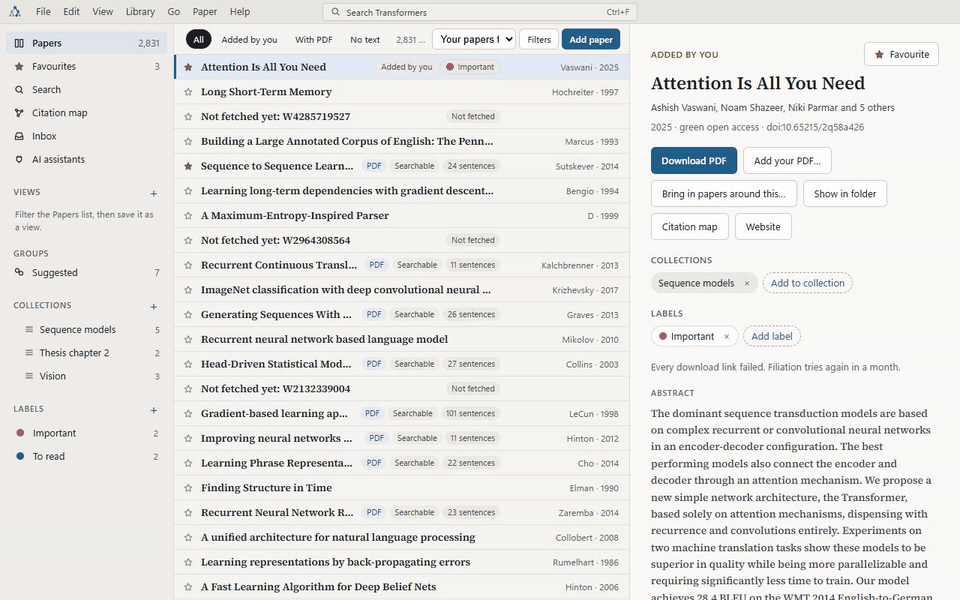
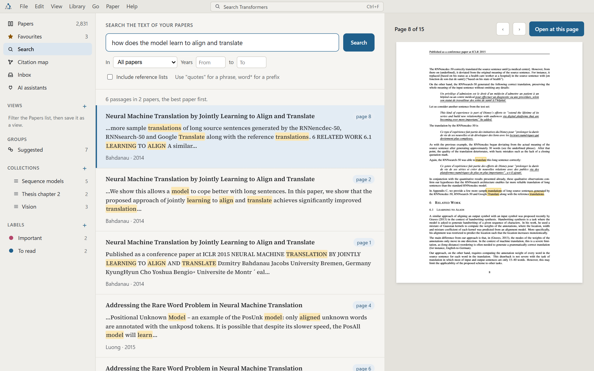
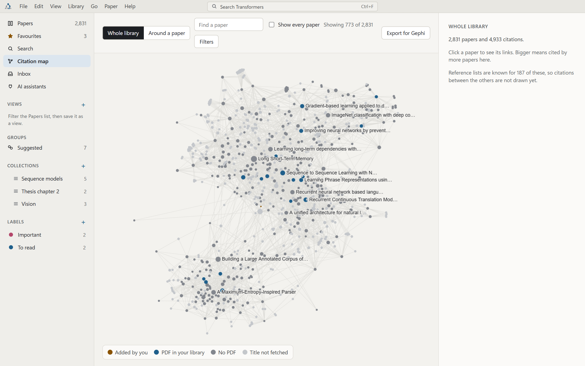
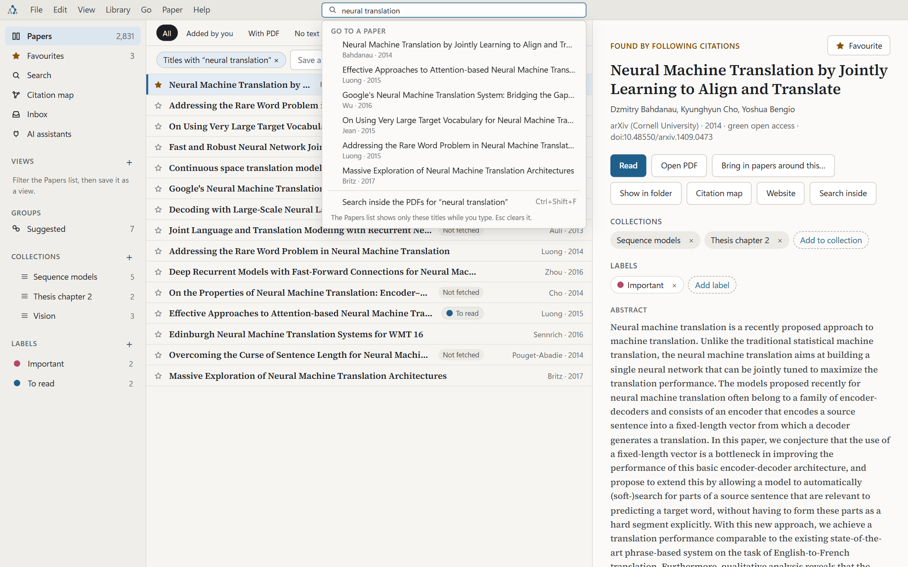
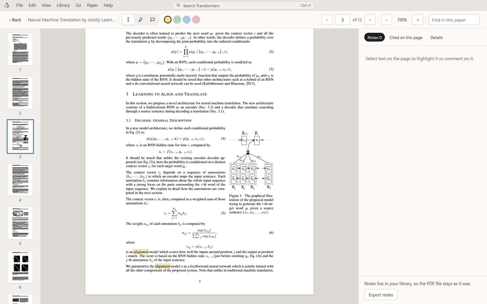
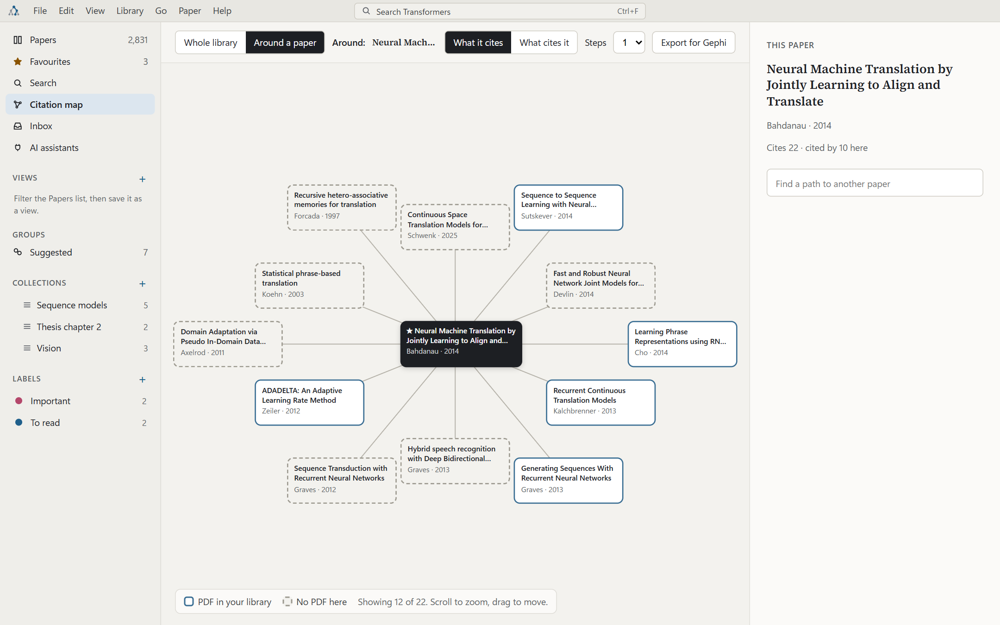
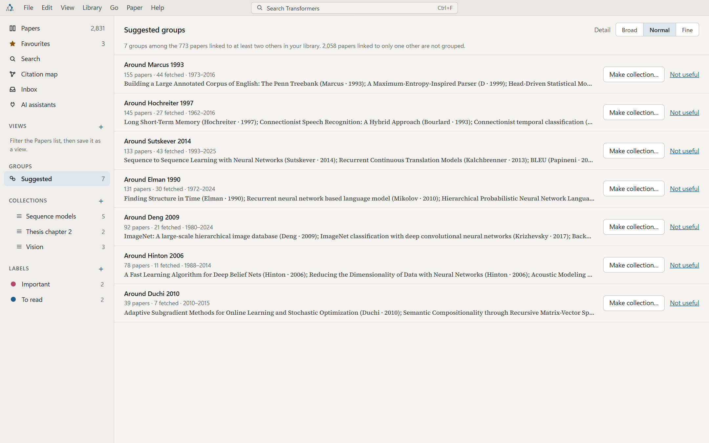

<p align="center">
  
</p>

<h1 align="center"> Filiation</h1>

<p align="center">
  <strong>Your research library, built from citations, ready for your AI assistant.</strong><br>
  Give it one paper. It follows the references, keeps the open-access PDFs, searches inside them to the page,<br>
  and lets your AI assistant use all of it, on your own machine.
</p>

<p align="center">
  <a href="https://github.com/codevector-2003/filiation/releases/latest"></a>
  <a href="LICENSE"></a>
  
  
  <a href="https://openalex.org"></a>
  <a href="https://doi.org/10.5281/zenodo.24505907"></a>
</p>

<p align="center">
  <a href="https://codevector-2003.github.io/filiation/"><strong>Website</strong></a> ·
  <a href="https://codevector-2003.github.io/filiation/docs/"><strong>Documentation</strong></a> ·
  <a href="https://github.com/codevector-2003/filiation/releases/latest"><strong>Download</strong></a>
</p>

<p align="center">
  <a href="#two-ways-in">Get started</a> ·
  <a href="docs/MCP.md">AI assistants</a> ·
  <a href="docs/COMMANDS.md">Commands</a> ·
  <a href="docs/HOW_IT_WORKS.md">How it works</a> ·
  <a href="#roadmap">Roadmap</a>
</p>

<p align="center">
  
</p>

---

## What it does

**Builds your library from one paper.** Start from a DOI, an arXiv ID, a link or a title. Filiation follows the reference lists, most-cited first, and keeps what it finds: hundreds of related papers, each tied to the papers it cites.

**Keeps the papers themselves, searchable to the page.** It downloads the legal open-access PDFs and reads them. Type a few keywords and it finds the passages that match, names their page, and lights them on the PDF.

<p align="center">
  
</p>

**Works with your AI assistant.** Claude, GitHub Copilot, Cursor and Gemini CLI can search your library, read the passages and answer with the page they came from, so you can check every claim. Your assistant writes the answer; Filiation gives it sources that are yours.

**Shows where ideas came from.** See what a paper cites and what cites it, find the chain of citations between two papers, and let the citations group your library into its topics.

<p align="center">
  
</p>

## Two ways in

<table>
<tr>
<td width="50%" valign="top">

### Use the app

A desktop window for Windows, macOS and Linux, for people who would rather not use a terminal: your papers, search, the citation map, the Reader with highlights, notes and several papers open in tabs, and connecting your AI assistant with one click. On Windows it keeps itself up to date.

On Windows, [download the installer](https://codevector-2003.github.io/filiation/docs/install/): no administrator rights needed. On macOS and Linux the app builds from source for now: see [the desktop app](desktop/README.md).

</td>
<td width="50%" valign="top">

### Use the command line

Download `fil` for your system from **[Releases](https://github.com/codevector-2003/filiation/releases)**, unpack it, and run it. Nothing else to install.

```sh
fil add 10.7717/peerj.4375        # one paper, by DOI, arXiv ID, link or title
fil expand                        # follow its references, most-cited first
fil fetch                         # download the open-access PDFs, and read them
fil search "citation advantage"   # find passages, with their paper and page
```

</td>
</tr>
</table>

To let your AI assistant use your library, connect it to `fil mcp`. For Claude Code:

```sh
claude mcp add filiation -- fil mcp
```

Other assistants, all nine tools, and troubleshooting: **[AI assistants](docs/MCP.md)**. Every command: **[Commands](docs/COMMANDS.md)**. Install, first steps, and where your library lives: **[Getting started](docs/GETTING_STARTED.md)**.

## A closer look

<table>
<tr>
<td width="50%" valign="top"><br><sub><b>Find any paper as you type.</b> The search box in the title bar filters your library and offers papers to jump to.</sub></td>
<td width="50%" valign="top"><br><sub><b>Read and mark up.</b> Highlights and notes live in your library, so the PDF file stays as it was.</sub></td>
</tr>
<tr>
<td width="50%" valign="top"><br><sub><b>The map around a paper.</b> What it cites, what cites it, and which of them you have the PDF for.</sub></td>
<td width="50%" valign="top"><br><sub><b>Topics from the citations alone.</b> Groups of papers that cite one another, offered as collections. No model guesses what a paper is about.</sub></td>
</tr>
</table>

## Why you can trust it

- **Yours, and on your machine.** Your library is a folder you choose, with readable PDF folders inside. It never leaves your computer, and it exports to GraphML for Gephi or NetworkX.
- **Open access only, always.** Filiation downloads only legal open-access copies, never from behind a paywall or through anyone's login. For the rest, add the PDF you have.
- **No model guessing.** Citations come from [OpenAlex](https://openalex.org)'s resolved reference lists, not from a language model reading papers. Search ranks passages with plain keyword scoring, measured on a fixed test set, and runs nothing extra on your machine.
- **Honest about the data.** Reference lists are rich in the sciences and thin in the humanities, and most papers have no open copy. Filiation says so, paper by paper, rather than looking broken.
- **One file, nothing to install.** No runtime, no database server, no account, no API key.

## Roadmap

| Milestone | | Status |
| --- | --- | --- |
| **The graph** | Follow references under a budget, without duplicates; paths, neighbours, export | Done, v0.1 |
| **AI assistants** | Your library as MCP tools | Done, v0.2 |
| **Papers on disk** | Open-access PDFs, full text, and the sentence behind each citation | Done, v0.3 |
| **Search** | Find the paper that answers your question, ranked by its passages, title and abstract | Done, v0.4 |
| **The desktop app** | Everything above in a window, for people who don't use a terminal | In progress |
| **Claim genealogy** | Why each paper cites another, and tracing a claim to its earliest source | Planned |

## Documentation

**Using Filiation**: [Getting started](docs/GETTING_STARTED.md) · [Commands](docs/COMMANDS.md) · [AI assistants](docs/MCP.md) · [How it works](docs/HOW_IT_WORKS.md)

**Building Filiation**: [Status](docs/STATUS.md) · [Architecture](docs/ARCHITECTURE.md) · [Decisions](docs/DECISIONS.md) · [Spikes](docs/SPIKES.md) · [Validation](docs/VALIDATION.md) · [CLAUDE.md](CLAUDE.md)

## Contributing

Issues and pull requests are welcome. Read [CONTRIBUTING.md](CONTRIBUTING.md) first: how to build and test, the rules every change keeps, commit style, and the rules for AI-assisted work. A few rules are non-negotiable: no cgo in `fil` itself (the desktop shell is the one exception), no paywalled full text, no reference parsing, and no network in unit tests.

## Citing Filiation

If Filiation helps your research, please cite it. GitHub's **Cite this repository** button, on the right of the repository page, gives APA and BibTeX from [`CITATION.cff`](CITATION.cff). Every release is archived on Zenodo: [10.5281/zenodo.24505907](https://doi.org/10.5281/zenodo.24505907) always names the newest, and each version has a DOI of its own.

## Why "Filiation"?

In textual criticism, **filiation** is the work of establishing which manuscript was copied from which: reconstructing the lines of descent between surviving texts. Filiation does the same for research papers. Start from one paper, follow its citations back, and see the literature it grew out of.

## Acknowledgements

Reference data comes from [OpenAlex](https://openalex.org), an open index of the world's research. SQLite runs in pure Go through [`ncruces/go-sqlite3`](https://github.com/ncruces/go-sqlite3). PDF text comes from [PDFium](https://pdfium.googlesource.com/pdfium/), compiled to WebAssembly by [`klippa-app/go-pdfium`](https://github.com/klippa-app/go-pdfium) and run by [`wazero`](https://github.com/tetratelabs/wazero). PDFs are shown with [PDF.js](https://mozilla.github.io/pdf.js/). The desktop window uses [Wails](https://wails.io). The command line is built with [`spf13/cobra`](https://github.com/spf13/cobra).

## Licence

[Apache License 2.0](LICENSE). Use it, change it, and build on it, including commercially; keep the notices in [`NOTICE`](NOTICE). The licence includes an explicit patent grant from contributors.
